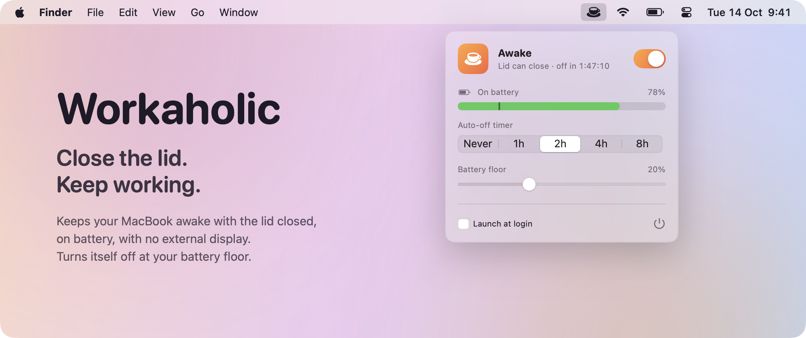

# Workaholic

<picture>
  <source media="(prefers-color-scheme: dark)" srcset="assets/screenshot-dark.png">
  
</picture>

A menu-bar switch that keeps a MacBook awake with the lid closed, on battery, with no external display. One Swift file, no daemon, no dependencies. macOS 13+.

## Install

```sh
./install.sh
```

The script compiles the app with `swiftc` from Apple's Command Line Tools (no Xcode app needed; most Macs used for development already have them, otherwise run `xcode-select --install`), puts it in `/Applications`, and installs one sudoers rule:

```
<you> ALL=(root) NOPASSWD: /usr/bin/pmset -a disablesleep 0, /usr/bin/pmset -a disablesleep 1
```

sudoers matches arguments literally, so the rule permits those two commands and nothing else. The rule is what lets Workaholic switch sleep back on by itself when you are away from the Mac.

## Use

Click the cup in the menu bar and flip the switch, then close the lid. A filled cup means lid-close sleep is off.

Workaholic turns itself off when:

- the battery drops to the **Battery Floor** while on battery (5–50%, default 20%)
- the **Auto-off Timer** ends (never, 1, 2, 4 or 8 hours)
- the Mac reaches a critical thermal state
- you quit it

It always starts in the off state, so after a crash or force-quit, the next launch restores normal sleep.

## How it works

`pmset -a disablesleep 1` sets the kernel's `SleepDisabled` flag, the one setting that overrides lid-close sleep. Power assertions (`caffeinate`, Amphetamine's default mode) cannot. Workaholic reads the flag back from `pmset -g`, so the icon always shows the real state. You can check it yourself with `pmset -g | grep SleepDisabled`.

A closed Mac has little airflow, so heavy sustained work in a bag runs hot.

## Uninstall

Turn off **Launch at Login** first, then:

```sh
./uninstall.sh
```
